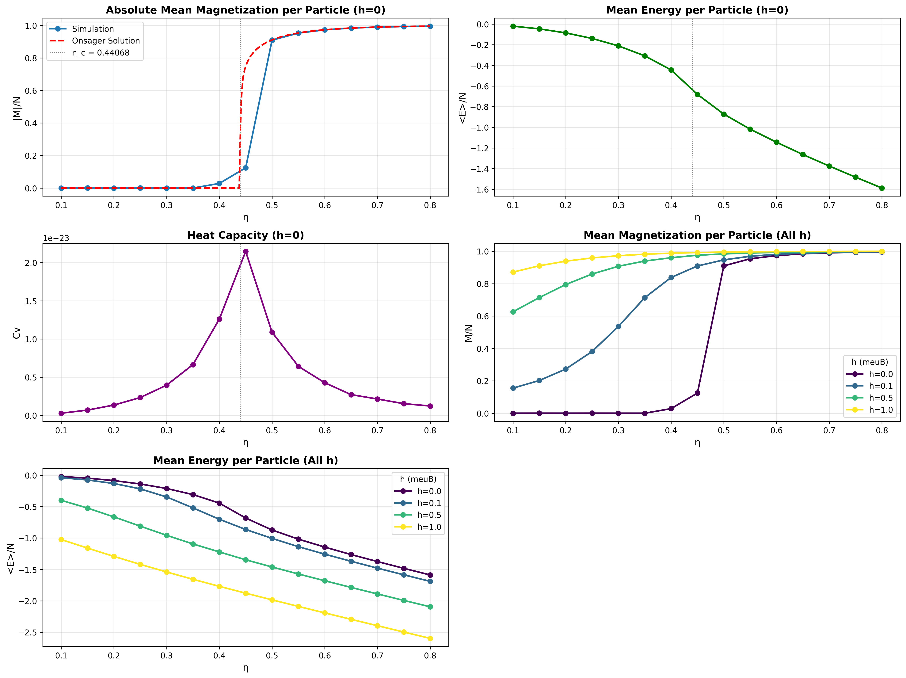

# 2D Ising Model: Monte Carlo Simulation

Monte Carlo simulation of the two-dimensional Ising model on a 32 × 32 lattice, using the heat-bath algorithm, with the results compared to Onsager's exact solution. Developed for the Statistical Physics course at the Hebrew University of Jerusalem.



## What the code does

- **Heat-bath dynamics:** each spin is updated with probability P(flip) = e^(−E_flip) / (e^(−E_flip) + e^(−E_now)), based on its four nearest neighbours and the external field.
- **Performance:** the inner sweep loop is compiled with [Numba](https://numba.pydata.org/) for fast simulation of up to 10⁸ spin flips per run.
- **Equilibration and convergence:** a burn-in phase, then two measurement blocks whose mean magnetizations are compared to check that the system has converged.
- **Observables:** mean magnetization, mean energy and heat capacity per spin, as functions of the coupling η = J/k_BT and the external field h.

## Results

- With h = 0, the magnetization follows Onsager's exact solution away from the critical point and shows the phase transition near the critical coupling η_c ≈ 0.4407. The finite lattice smooths the transition slightly.
- The heat capacity peaks at η ≈ 0.45, close to η_c.
- A non-zero external field (h = 0.1, 0.5, 1.0) removes the sharp transition and magnetizes the system at all couplings.

## Files

- `ising_analysis.py`: simulation, analysis and plots
- `ising_results.png`: summary figure
- `Statistical Physics - Numeric Assignment 2 - Ising model.pdf`: full report

## How to run

```bash
pip install numpy numba matplotlib
python ising_analysis.py
```
